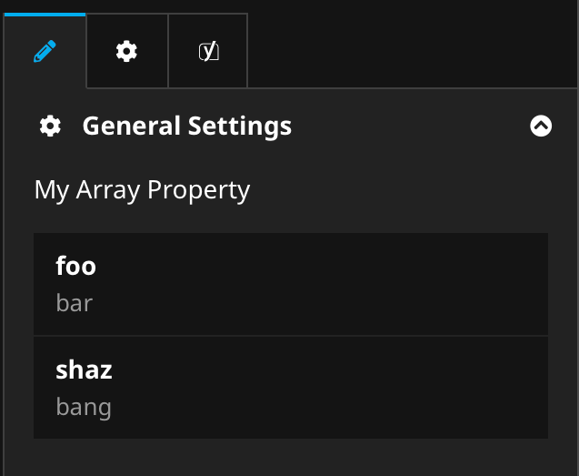

# UpAssist Neos Editors

Additional editors to be used in the Neos CMS.

## Compatibility

| Version | Neos |
| --- | --- |
| 1.2.x | 7.3 (in production, not tested in our dev installs), 8.3, 8.4, 9.0, 9.1, 9.2 |
| 1.1.x | 7.3 (in production, not tested in our dev installs), 8.3, 8.4, 9.0, 9.1, 9.2 |

## Installation

```bash
composer require upassist/neos-editors
```

## Development

The inspector editor is a Neos UI plugin, built with esbuild as described in the
[Neos UI extensibility guideline](https://github.com/neos/neos-ui/blob/9.2/packages/neos-ui-extensibility/README.md).
The built `Resources/Public/ArrayInfoEditor/Plugin.js` and `Plugin.css` are committed, so
installing the package needs no Node.

```bash
cd Resources/Private/Scripts
yarn install --frozen-lockfile
yarn build   # or: yarn watch
```

Commit the rebuilt files in `Resources/Public` together with the source change; CI checks that they match.

## ArrayInfoEditor

### What it does
This editor shows rough array information in the same layout as the nodeView shows detailed information.

### When to use
When you store information to a node in the form of an array and want to show the details in the inspector.

### How to use
Add the editor to your configuration:

```yaml
   properties:
     myArrayProperty:
       type: array
       ui:
         ...
         inspector:
           ...
           editor: UpAssist.Neos.Editors/Inspector/Editors/ArrayInfoEditor
```

### Example

